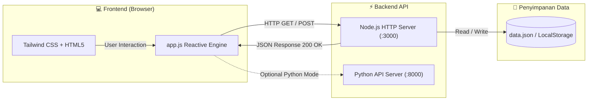

<div align="center">

# 🚀 My First-Code Fullstack Dashboard
### *The Ultimate Learning Hub & Project Starter by [@novalizerazizi](https://github.com/novalizerazizi)*

[](LICENSE)
[-339933?style=for-the-badge&logo=nodedotjs&logoColor=white)](https://nodejs.org/)
[](https://python.org/)
[](https://git-scm.com/)
[](https://tailwindcss.com/)
[](#)

<p align="center">
  <b>Selamat datang di repositori pertama saya!</b><br/>
  Proyek ini dirancang sebagai <i>Living Dashboard</i> dan hub pembelajaran menyeluruh untuk menguasai konsep <b>Fullstack Development</b> dari nol hingga mahir.
</p>

[✨ Buka Dashboard](#-fitur-utama) • [🗺️ Roadmap](#-peta-jalan-belajar-fullstack) • [⚡ Mulai Cepat](#-cara-menjalankan-proyek) • [📡 Dokumentasi API](#-dokumentasi-rest-api) • [📖 Panduan Git](docs/GIT_GUIDE.md)

---

</div>

## 🌟 Tentang Proyek

Repositori **`git-me-as`** bukan sekadar kode kosong, melainkan aplikasi Fullstack utuh yang siap dijalankan secara lokal. Proyek ini memadukan:
1. **Frontend Modern:** Dashboard interaktif dengan Tailwind CSS, Dark Mode, pelacak progres real-time, dan pemutar API live.
2. **Backend Node.js & Python:** Menyediakan RESTful API tanpa dependensi eksternal yang berat (*zero-dependency*), mudah dipahami untuk belajar arsitektur client-server.
3. **Dokumentasi & Git Workflow:** Panduan standar industri untuk commits, branch, dan manajemen proyek.

---

## 🏗️ Arsitektur Fullstack



---

## ✨ Fitur Utama Dashboard

| Fitur | Deskripsi |
| :--- | :--- |
| 📊 **Fullstack Roadmap Tracker** | Pantau progres belajar dari Fondasi Web, REST API, Database, hingga DevOps secara interaktif. |
| 🧪 **Live API Playground** | Uji endpoint backend (`/api/health`, `/api/profile`, `/api/modules`) langsung dari antarmuka browser. |
| 📝 **Dev Journal & Notes** | Catat pemahaman baru, solusi bug, atau ide proyek langsung ke penyimpanan data backend. |
| 💡 **Curated Code Snippets** | Koleksi kode siap pakai (JavaScript async/await, Node HTTP, FastAPI, Git Commands) dengan tombol 1-klik salin. |
| ⏱️ **Real-time Server Health** | Menampilkan uptime server, status koneksi 200 OK, dan spesifikasi runtime secara live. |

---

## 🗺️ Peta Jalan Belajar Fullstack

```
[=======>                   ] 50% Tercapai (3 / 6 Modul Selesai)
```

- [x] **Modul 1: Web Foundations** *(HTML5, Modern CSS, JavaScript ES6+)*
- [x] **Modul 2: Git & Version Control** *(Branching, Commits, Pull Requests, GitHub CLI)*
- [x] **Modul 3: Backend Core & REST API** *(Node.js HTTP Server, Python API, JSON Serialization)*
- [ ] **Modul 4: Data Persistence & Databases** *(PostgreSQL, SQLite, Redis, Relational Schemas)*
- [ ] **Modul 5: Authentication & Security** *(JWT Tokens, bcrypt, CORS, Environment Variables)*
- [ ] **Modul 6: DevOps & Cloud Deployment** *(Docker, GitHub Actions CI/CD, Production Hosting)*

> Detail lengkap kurikulum tersedia di [docs/ROADMAP.md](docs/ROADMAP.md).

---

## ⚡ Cara Menjalankan Proyek

### 1. Clone Repositori
```bash
git clone https://github.com/novalizerazizi/git-me-as.git
cd git-me-as
```

### 2. Jalankan Backend & Dashboard (Node.js)
```bash
npm start
```
Buka browser Anda di: **`http://localhost:3000`**

### 3. (Opsional) Jalankan Backend Python
Jika Anda ingin mencoba backend versi Python:
```bash
python backend/app.py
```
API akan aktif di: **`http://localhost:8000/api/health`**

---

## 📡 Dokumentasi REST API

| Method | Endpoint | Deskripsi | Status Code |
| :--- | :--- | :--- | :--- |
| `GET` | `/api/health` | Status server, versi Node/OS, uptime | `200 OK` |
| `GET` | `/api/profile` | Profil pengembang `@novalizerazizi` & statistik | `200 OK` |
| `GET` | `/api/modules` | Daftar modul roadmap dan progresnya | `200 OK` |
| `POST` | `/api/modules/:id/toggle` | Tandai modul selesai / belum | `200 OK` |
| `GET` | `/api/notes` | Ambil semua catatan Dev Journal | `200 OK` |
| `POST` | `/api/notes` | Tambah catatan belajar baru | `201 Created` |
| `DELETE` | `/api/notes/:id` | Hapus catatan berdasarkan ID | `200 OK` |
| `GET` | `/api/snippets` | Daftar potongan kode esensial Fullstack | `200 OK` |

---

## 📁 Struktur Direktori

```text
git-me-as/
├── backend/
│   ├── server.js          # REST API & Web Server (Node.js)
│   ├── app.py             # Alternatif REST API (Python)
│   └── data.json          # Database JSON lokal
├── frontend/
│   ├── index.html         # Antarmuka Dashboard utama
│   ├── styles.css         # Styling custom & font
│   └── app.js             # Logika interaktif & pemanggil API
├── docs/
│   ├── ROADMAP.md         # Kurikulum belajar terstruktur
│   └── GIT_GUIDE.md       # Panduan Git harian profesional
├── .gitignore             # Menjaga file sensitif (.env) tetap aman
├── package.json           # Skrip eksekusi proyek
├── LICENSE                # Lisensi open-source (MIT)
└── README.md              # Dashboard dokumentasi repositori
```

---

## 👤 Pengembang

* **GitHub:** [@novalizerazizi](https://github.com/novalizerazizi)
* **Email:** [robertverthli@gmail.com](mailto:robertverthli@gmail.com)
* **Motto:** *"Code every day, learn every step, build for the future."*

---

<div align="center">
  <sub>Lisensi di bawah <a href="LICENSE">MIT License</a>. Dibuat dengan antusiasme untuk dunia Fullstack Engineering.</sub>
</div>
