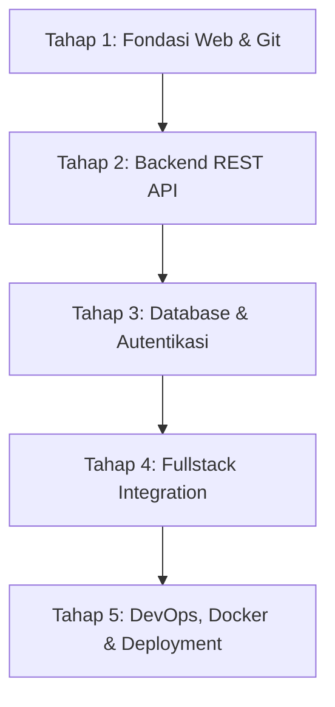

# 🗺️ Fullstack Developer Roadmap & Curriculum

Selamat datang di peta jalan pembelajaran **Fullstack Developer** yang disusun khusus untuk perjalanan belajar `@novalizerazizi`.

---

## 🧭 Tahapan Pembelajaran (Milestones)

---

### 1. Tahap 1: Fondasi Frontend & Git
- [x] **HTML5 Semantik:** Struktur halaman yang ramah SEO dan aksesibilitas.
- [x] **CSS Modern:** Flexbox, CSS Grid, responsif mobile-first, dan utilitas Tailwind CSS.
- [x] **JavaScript ES6+:** Let/const, arrow functions, destructuring, promises, async/await.
- [x] **Version Control (Git):** Staging, commits, branching, push/pull ke GitHub.

### 2. Tahap 2: Backend Core & API Design
- [x] **Node.js Runtime:** Arsitektur event loop, asynchronous non-blocking I/O.
- [x] **Python Basics:** Struktur data, modul, virtual environment (`venv`).
- [x] **RESTful API Principles:** HTTP status codes (`200`, `201`, `400`, `404`, `500`), request headers, JSON payloads.
- [ ] **Middleware:** Logging, error handling, CORS, sanitasi input.

### 3. Tahap 3: Database & Relasi Data
- [ ] **Relational Database:** PostgreSQL atau SQLite, konsep tabel, foreign keys, indexing.
- [ ] **NoSQL & Caching:** Redis (caching), MongoDB (dokumen).
- [ ] **ORM / Query Builders:** Prisma, Sequelize (Node.js) atau SQLAlchemy (Python).
- [ ] **Migrasi Database:** Menjaga riwayat perubahan skema.

### 4. Tahap 4: Autentikasi & Keamanan Web
- [ ] **Authentication Flow:** JSON Web Token (JWT), refresh tokens, HTTP-only cookie.
- [ ] **Enkripsi:** Hashing password dengan bcrypt / argon2.
- [ ] **Proteksi API:** Rate limiting, Cross-Origin Resource Sharing (CORS), XSS prevention.

### 5. Tahap 5: DevOps, CI/CD & Deployment
- [ ] **Containerization:** Dockerfile, Docker Compose.
- [ ] **Automated CI/CD:** GitHub Actions (linting, automated tests on push).
- [ ] **Cloud Deployment:** Hosting di Render, Railway, Vercel, atau VPS Linux.

---

> *"Belajar coding bukan tentang menghafal sintaks, melainkan tentang membangun pola pikir pemecahan masalah secara konsisten."*
